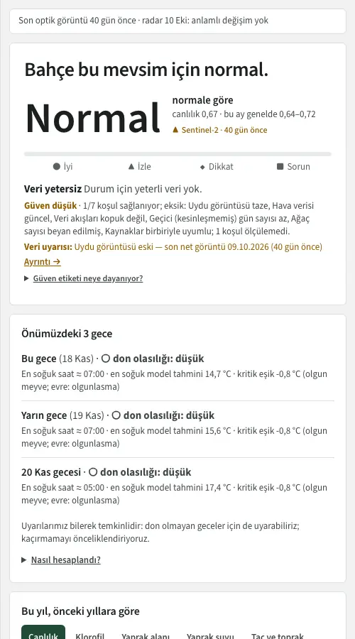
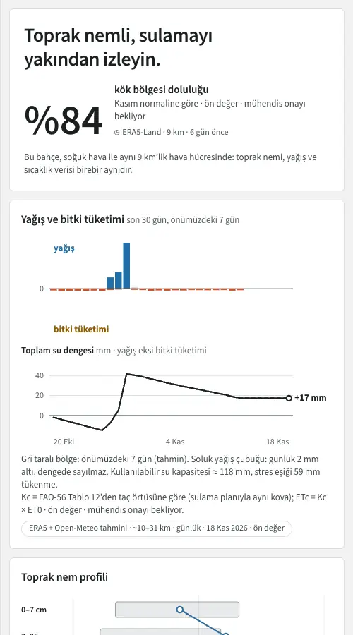
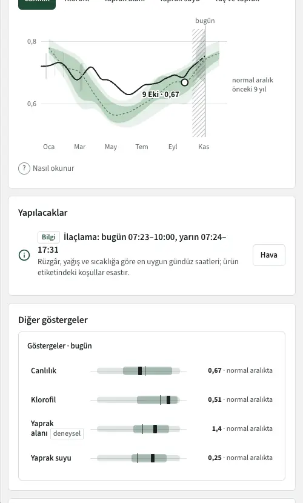
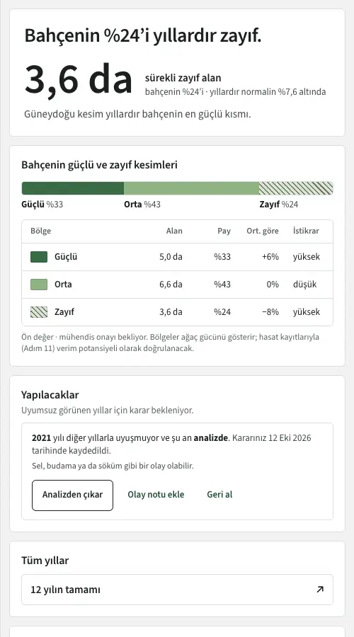
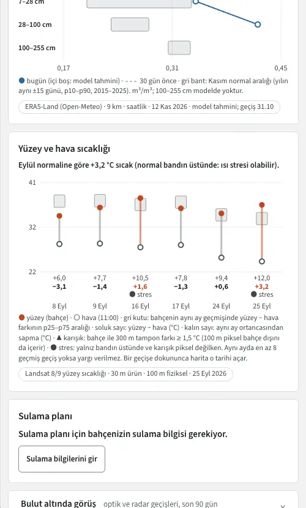

# Sağ panel · tasarımcı değerlendirmesi ve sadeleştirme önerisi

> **Kapsam:** bahçe seçildikten sonra haritanın sağındaki panel (Durum, Analiz, Su; Hava yalnız koddan). **Yöntem:** gerçek bahçe verisiyle canlı uygulama, 1440×900, açık tema; panelde kelime, kart, yazı boyutu ve etkileşimli öğe sayımı (Playwright). **Kod değişmedi**, bu belge yalnız değerlendirme ve öneridir.
> **Hava sekmesi** canlı ölçülmedi (hava verisi çekimi veritabanına önbellek yazar); bulgular koddaki bileşen listesine ve eski denetime ([ux-denetimi.md](ux-denetimi.md) B6) dayanır.
> İlgili: [KOMUTA-MERKEZI.md](KOMUTA-MERKEZI.md) ilke 4 («önce özet, sonra derinlik»; brifing tek ekrana sığar), [ux-denetimi.md](ux-denetimi.md) U-11, U-12, U-13, U-16.

## Kısa yargı

Haklısınız. Panel bir **karar ekranı değil, bir rapor sayfası**. Çiftçi «bahçem nasıl, ne yapmalıyım?» diye sorarken ilk ekranda **272 kelime** okuması gerekiyor. Bilgi azaltılmadan düzenlenmediği için her şey aynı ağırlıkta: 8 çerçeveli kart, 22 tıklanabilir öğe, 5 açılır bölüm, tek bir büyük başlık ve geri kalan her şey 13 px.

Sorun veri miktarı değil, **hiyerarşi ve tekrar**. Aynı gerçek (örneğin «uydu görüntüsü eski») Durum panelinde dört yerde, dört farklı cümleyle söyleniyor.

## 1. Ölçümler (jlnnlk, 1440×900, panel genişliği 499 px)

| | Durum | Analiz | Su | Hedef (ilk ekran) |
|---|---|---|---|---|
| **İlk ekranda kelime** | **272** | 132 | 154 | ≤ 60 |
| Tüm panelde kelime | 641 | 201 | **1045** | ≤ 150 |
| İçerik yüksekliği (görünür alan 792 px) | ≈ 1810 px (2,3 ekran) | 942 px | 1804 px (2,3 ekran) | 1 ekran, kaydırma yok |
| Çerçeveli kart | 8 | 7 | 7 | ≤ 3 |
| Tıklanabilir öğe | 22 | 5 | 4 | ≤ 6 |
| Açılır bölüm (iç içe) | 5 | 1 | 2 | 0 (ayrıntı ayrı yüzeyde) |
| 12 px yazı (kelime payı) | %17 | %20 | **%27** | 0 (birincil içerikte) |
| 13 px yazı (kelime payı) | %71 | %62 | %28 | |
| ≥ 28 px başlık/rakam | 6 kelime | 6 kelime | 6 kelime | |

Yazı boyutu ölçeğinde fiilen **iki kademe** var: dev rakam (60 px) ve küçük metin (12–13 px). Başlık, alt başlık ve gövde arasında görsel fark yok; göz nereye bakacağını bilmiyor.



## 2. Bulgular (önem sırasıyla)

**P0 · Aynı karta çelişen iki mesaj.** Durum kartı büyük harfle «Normal» diyor, hemen altında «Veri yetersiz · Durum için yeterli veri yok». Çiftçi hangisine inanacağını bilmiyor. Kademe şeridi (İyi · İzle · Dikkat · Sorun) hiçbir seviyeyi vurgulamıyor, yani dört etiketlik boş bir çubuk. Veri yetersizse başlık «Normal» olmamalı; başlığın kendisi «Karar için veri eski» demeli.

**P0 · Bir bilgi dört kez.** «Uydu görüntüsü eski» şuralarda geçiyor: üstteki şerit («Son optik görüntü 40 gün önce»), rakamın altındaki ▲ rozeti («Sentinel-2 · 40 gün önce»), «Veri uyarısı: Uydu görüntüsü eski, son net görüntü 09.10.2026 (40 gün önce)» ve alttaki «Veri durumu · 3 bileşende veri eski» bölümü. Analiz ve Su'da «ön değer · mühendis onayı bekliyor» her kartta tekrar ediyor.

**P1 · Kalite ve mühendislik içeriği çiftçinin okuma yolunda.** «Güven düşük · 1/7 koşul sağlanıyor; eksik: Uydu görüntüsü taze, Hava verisi güncel, Veri akışları kopuk değil, Geçici (kesinleşmemiş) gün sayısı az, Ağaç sayısı beyan edilmiş…», «Güven etiketi neye dayanıyor?», «Kc = FAO-56 Tablo 12'den taç örtüsüne göre; ETc = Kc × ET0», «p25–p75», «gri kutu: bahçenin aynı ay geçmişinde yüzey-hava farkının…». Bunlar ekip ve denetim içindir; birincil panelde yer almamalı. Analiz dipnotunda **«Adım 11»** iç yol haritası metni bile var.

**P1 · Her şey aynı kart.** Karar (Durum), uyarı (Don), grafik (Sezon), eylem (Yapılacaklar), gösterge listesi ve açıklama aynı çerçeve, aynı iç boşluk, aynı gölgesiz beyaz kutu. Kart sayısı hiyerarşi yerine geçiyor; vurgu yok.

**P1 · İç içe katmanlar.** Kart içinde açılır bölüm, onun içinde rozet, onun içinde bağlantı («Nasıl hesaplandı?» kartın içinde, bir de panel altında ayrıca «Nasıl hesaplandı?» akordeonu). Kullanıcı üç yerde «nasıl» arıyor, her biri farklı içerik açıyor.

**P1 · Bilgi sıfır olan satırlar yer kaplıyor.** «Önümüzdeki 3 gece» kartı üç gece için aynı şeyi söylüyor («don olasılığı: düşük»), her biri üç satır; altına bir uyarı paragrafı ve «Nasıl hesaplandı?» ekleniyor. «Önemli bir şey yok» durumu panelin üçte birini tutuyor.

**P1 · Grafik açıklaması grafikten uzun.** Su sekmesinde «Yağış ve bitki tüketimi» grafiğinin altında 5 satırlık, «Yüzey ve hava sıcaklığı» altında 6 satırlık 12 px paragraf var. Grafik kendini anlatmıyor, metin anlatıyor.

**P2 · Sekmeler konu adı, soru değil.** Durum · Analiz · Su · Hava · Günlük · Rapor. «Analiz» ile «Durum» arasındaki farkı yeni kullanıcı bilmiyor; Günlük ve Rapor yer tutucu ama aktif sekme gibi duruyor (U-24).

**P2 · Dar sütun.** 499 px'te grafikler sıkışıyor, dumbbell grafiğinde etiketler üst üste biniyor, bu da metni 12 px'e itiyor.



## 3. Tasarım ilkeleri (öneri)

1. **Bir ekran, bir soru.** Panel yalnız «Bahçem nasıl, ne yapmalıyım?» sorusunu yanıtlar. Kaydırma gerektirmez (KOMUTA-MERKEZI ilke 4'ün ölçülebilir hâli).
2. **Üç kademe: Karar → Kanıt → Ayrıntı.** Karar: tek cümle + tek rakam (28–60 px). Kanıt: tek satır (15 px): kaynak ve yaş. Ayrıntı: yalnız bağlantı, içerik başka yüzeyde.
3. **Her gerçek bir kez.** Veri yaşı, güven ve «ön değer» tek bir **güven rozetine** iner; ayrıntısı rozete dokununca açılır.
4. **Ayrıntı satır içinde açılmaz.** Açılır bölüm yerine **ayrıntı çekmecesi** (haritanın üstüne gelen 720 px yüzey). Panelde iç içe katman kalmaz.
5. **Boş durum yer kaplamaz.** «Don yok, sulama gerekmiyor» tek satırdır; ayrıntı çekmecede.
6. **Çerçeve vurgudur.** Yalnız karar kartı çerçeveli; geri kalan satırlar çizgiyle ayrılır. Üç kademeli yazı: 28/60 (karar), 15 (gövde), 13 (ikincil). 12 px yalnız grafik ekseninde.
7. **Mühendislik içeriği ayrı yerde.** «Güven nasıl hesaplandı», koşul listesi, formüller, kaynak ayrıntısı yalnız «Veri ve yöntem» çekmecesinde.

## 4. Öneri · Durum paneli (ana öneri)

Bugün 1810 px olan panel tek ekrana inir (≈ 55 kelime).

```
┌────────────────────────────────────────┐
│ jlnnlk · Limon · 15,1 da          ⋯   │  ← bahçe çubuğunda zaten var, panelde tekrar yok
├────────────────────────────────────────┤
│                                        │
│  Bahçe bu mevsim normal                │  ← karar (28 px)
│  0,67                                  │  ← tek rakam (60 px)
│  normal aralık 0,64–0,72               │  ← 15 px
│                                        │
│  ● Veri 40 gün eski  ⓘ                 │  ← güven rozeti (tek yer, tek cümle)
├────────────────────────────────────────┤
│  Bugün                                 │
│   ☂  İlaçlama için en iyi saat         │
│      07:23–10:00                    →  │
│   ❄  Don riski: düşük (3 gece)      →  │
│   💧 Sulama: gerekmiyor (7 gün)     →  │
├────────────────────────────────────────┤
│  Bu sezon   ╭──╮_╭─╮  normal aralıkta   │  ← tek mini grafik, etiket yok
│                                        │
│  [ Ayrıntıları aç ]                    │
└────────────────────────────────────────┘
```

Kurallar:
- **Başlık veriye dürüst.** Veri taze ve yeterli: «Bahçe bu mevsim normal». Veri eski: başlık «Karar için veri eski» olur, rakam gri, rozet amber. «Normal» ile «Veri yetersiz» aynı anda görünmez.
- **Kademe şeridi kalkar.** Seviye tek bir renkli nokta + sözcükle (İyi, İzle, Dikkat, Sorun) başlıkta söylenir; dört etiketlik boş çubuk yok.
- **«Bugün» listesi en çok 3 satır**, her satır: simge, tek cümle, ok. Satıra dokunmak ilgili çekmeceyi açar (ilaçlama → Hava, don → don ayrıntısı).
- **Güven rozeti** tek: «Veri güncel», «Veri 40 gün eski», «Veri yetersiz». ⓘ dokunulunca küçük bir popover: kaynak, tarih, en fazla 2 cümle. Koşul listesi buraya sığmaz, «Veri ve yöntem» çekmecesine gider.
- **Sezon grafiği** panelde yalnız eğri + normal bant, sekmesiz (varsayılan Canlılık). Klorofil, Yaprak alanı, Yaprak suyu, Taç ve toprak ayrıntı çekmecesinde.
- Panelde **«Diğer göstergeler»**, **«Veri durumu»**, **«Nasıl hesaplandı?»** yok.

### Ayrıntı çekmecesi (tek yüzey, dört sekme)

```
┌ Ayrıntı ────────────────────────── ✕ ┐
│ Sezon · Göstergeler · Veri ve güven · Yöntem │
│                                              │
│ (geniş grafik, 700 px; açıklama grafiğin     │
│  yanında 2–3 satır, «Nasıl okunur» tek yerde)│
└──────────────────────────────────────────────┘
```
Mevcut kartların tamamı (Sezon sekmeleri, Diğer göstergeler, Veri durumu, Nasıl hesaplandı, Don gece tablosu) **kaybolmaz**, çekmeceye taşınır. Çiftçi görmez, ekip bulur.

## 5. Öneri · Analiz paneli

Bugün 7 kart, tabloyla çubuğun aynı rakamları ikinci kez söylemesi:

```
┌────────────────────────────────────────┐
│ Bahçenin %24'ü yıllardır zayıf         │  ← karar
│ 3,6 da                                 │  ← rakam
├────────────────────────────────────────┤
│ ▓▓▓▓▓▓▓▓▓▒▒▒▒▒▒▒▒▒▒▒▒▒▒░░░░░░░░░       │  ← tek çubuk (Güçlü %33 · Orta %43 · Zayıf %24)
│  Güçlü       Orta        Zayıf         │
│  5,0 da      6,6 da      3,6 da        │  ← alan etiketi çubuğun altında
├────────────────────────────────────────┤
│ ◔ 1 karar bekliyor                  →  │  ← «Yapılacaklar» tek satır
│ 12 yılın tamamı                     →  │
└────────────────────────────────────────┘
```
- **Tablo kalkar**, çubuğun altına alan yazılır; «Ort. göre» ve «İstikrar» sütunları ayrıntı çekmecesine.
- Bir çubuk dilimine dokunmak haritada o bölgeyi vurgular (haritayla bağ, bugün yok).
- **«Yapılacaklar» kartı** uzman kararını (2021 yılı uyumsuz, «Analizden çıkar · Olay notu ekle · Geri al») birincil yere koyuyor. Bu bir ayar, karar değil: tek satırlık «1 karar bekliyor» olur, çekmecede açılır.
- Dipnottaki **«Adım 11»** iç metni kalkar; «ön değer» güven rozetinde söylenir.

## 6. Öneri · Su paneli

Bugün 1045 kelime, 3 grafik, 3 uzun açıklama paragrafı. Önerilen:

```
┌────────────────────────────────────────┐
│ Toprak nemli, sulama gerekmiyor        │  ← karar
│ %84   kök bölgesi doluluğu             │
│ ERA5-Land · 6 gün önce ⓘ               │
├────────────────────────────────────────┤
│ Su dengesi   ╭─╮__╱‾‾‾  +17 mm      →  │  ← tek çizgi, 7 gün tahmin gri
│ Toprak nemi  ░░▓▓░░░   normal       →  │
│ Sıcaklık     ● ● ○ ●   stres yok    →  │
├────────────────────────────────────────┤
│ Sulama planı kurulmadı  [ Bilgileri gir ]│
└────────────────────────────────────────┘
```
- Üç grafik **üç satırlık mini özet** olur (başlık, mini görsel, tek yargı). Dokununca tam grafik çekmecede açılır; **açıklama paragrafı grafiğin yanında 2–3 satır**, formüller («Kc = FAO-56…») «Yöntem» sekmesinde.
- Dumbbell grafiği (Yüzey ve hava sıcaklığı) panelde yok: etiket çakışması ve 6 satır açıklama çekmecede, geniş alanda.
- «Bu bahçe, X ile aynı 9 km hücrede» cümlesi rozet popover'ına taşınır (ve başka bahçenin adını ana metinde taşımaz).

## 7. Öneri · Hava paneli (koddan, ölçülmedi)

Sekme (`WeatherTab`) en az yedi bileşen içeriyor: Şimdi, Sulama, Riskler, Günlük tahmin, İlaçlama şeridi, Su, Uyarılar; yanında «en iyi ilaçlama» bandı bileşeni var. Aynı ilke: **tek karar** («İlaçlamak için en iyi saat: bugün 07:23–10:00»), altında 7 günlük tek şerit, gerisi çekmecede. Bugünkü panelin Durum ekranındaki «Yapılacaklar» satırıyla çakışan içeriği (ilaçlama saati) ayrıca bir kez gösterilir.

## 8. Alternatifler (değerlendirdim, önermiyorum)

| Seçenek | Neden elendi |
|---|---|
| **Paneli genişletmek** (499 → 640 px) | Yoğunluğu çözmez, haritayı küçültür; metin hâlâ aynı |
| **Yazıyı küçültüp daha çok kart sığdırmak** | Tersi gerekli; 12 px zaten %17–27 |
| **Sekmeleri artırmak** (Durum / Don / Sezon / Göstergeler…) | Gezinme maliyeti, bilgiyi dağıtır; çiftçi hangi sekmede arayacağını bilmez |
| **Her şeyi akordeona koymak** | Bugünkü iç içelik zaten buradan geliyor; başlık sayısı artar, hiyerarşi gelmez |
| **Harita üstü yorum balonlarıyla paneli boşaltmak** (KOMUTA-MERKEZI ilke 3) | Doğru yön ve kısmen zaten var («zayıf kesim · 3,6 da»); ama panelin karar rolünü karşılamaz. Bu öneriyle **birlikte** düşünülmeli |

## 9. Kabul ölçütleri (uygulandığında)

Aynı ölçüm betiğiyle (bu belgedeki tablo) doğrulanır:

- Durum, Analiz, Su: **ilk ekranda ≤ 60 kelime**, **kaydırma yok** (1440×900 ve 390×844).
- Çerçeveli kart ≤ 3, tıklanabilir öğe ≤ 6, panelde açılır bölüm 0.
- Birincil içerikte 12 px yazı 0, gövde 15 px.
- «Normal» ile «Veri yetersiz» aynı anda görünmez (birim test: veri durumu × başlık matrisi).
- Aynı gerçek bir kez: «veri yaşı» metni panelde tek yerde (testle).
- Kullanılabilirlik: 5 üretici, «bahçen nasıl, ne yapmalısın?» sorusu, 10 saniye içinde doğru yanıt; ilk bakış süresi ölçülür.
- Mühendislik içeriği kaybolmaz: her eski kart çekmecede karşılığıyla duruyor (kapsam listesi).

## 10. Uygulama sırası (öneri)

1. **Başlık dürüstlüğü** (P0): «Normal» + «Veri yetersiz» çelişkisi; kademe şeridinde seçili seviye. Küçük iş.
2. **Güven rozeti** + tekrarların kaldırılması (veri yaşı dört yerden bire).
3. **Ayrıntı çekmecesi** iskeleti; Sezon, Diğer göstergeler, Veri durumu, Nasıl hesaplandı oraya taşınır.
4. **Durum paneli** yeni düzen (§4).
5. Su ve Analiz (§5, §6), sonra Hava (§7).
6. Mobil (390 px): panel alt sayfa; «Bugün» listesi ilk kıvrımda.

Önce 1 ve 2 tek başına bile ilk ekranı yaklaşık yarıya indirir (272 → ≈ 130 kelime), çünkü tekrarlar ve kalite metni gider.

## Ekler

  

Ölçüm betiği ve ham sayılar: oturum çıktısı (`panel-olc.mjs`, `panel-ilk.mjs`); gerekirse `scripts/` altına alınır.
