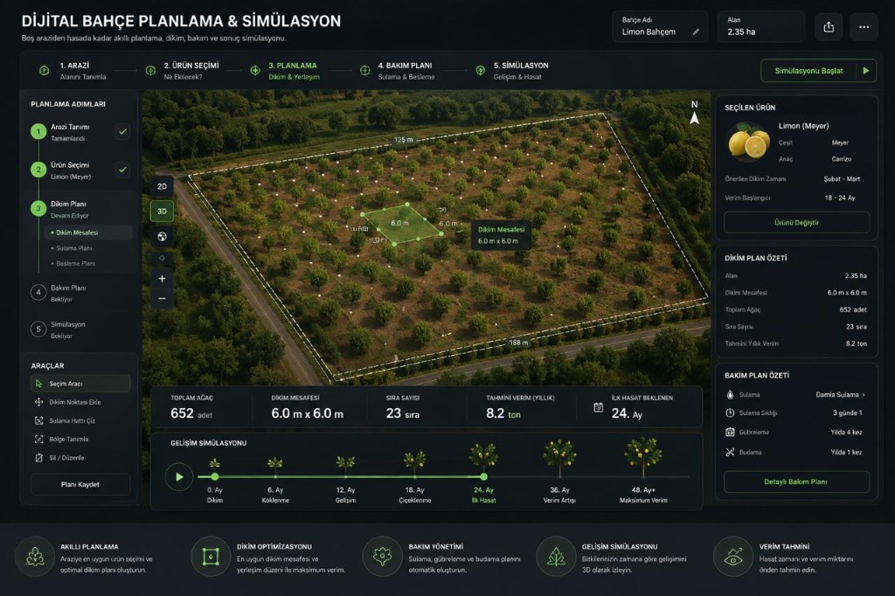

# Phase 1 B — Ekran Spec (Referans Görsel)

> **Görsel:** [reference-design.md](../reference-design.md)  
> 

## Layout Grid

```
┌───────────────────────────────────────────────────────────────┐
│ HEADER (h: ~64px)                                             │
│ Sol: Başlık + alt açıklama                                    │
│ Sağ: Bahçe adı | Alan | Share | ⋯ | [Simülasyonu Başlat]    │
├───────────────────────────────────────────────────────────────┤
│ TOP STEPPER (h: ~48px)                                        │
│ 1.ARAZİ → 2.ÜRÜN → [3.PLANLAMA] → 4.BAKIM → 5.SİMÜLASYON   │
├──────────┬────────────────────────────────────────┬───────────┤
│ SOL      │ ORTA — Spatial Canvas                  │ SAĞ       │
│ (w:224)  │ (flex-1)                               │ (w:288)   │
│          │                                        │           │
│ Adımlar  │ Harita / 2D-3D workspace              │ Ürün card │
│ Araçlar  │                                        │ Dikim özet│
│ [Kaydet] │                                        │ Bakım özet│
├──────────┴────────────────────────────────────────┴───────────┤
│ METRICS BAR (h: ~72px) — 5 KPI                              │
├───────────────────────────────────────────────────────────────┤
│ GROWTH TIMELINE (h: ~96px) — Play + milestones              │
├───────────────────────────────────────────────────────────────┤
│ FEATURE FOOTER (h: ~48px) — 5 özellik ikonu                 │
└───────────────────────────────────────────────────────────────┘
```

## Bileşen → Dosya Eşleşmesi

| UI Bölümü | Component | Dosya |
|-----------|-----------|-------|
| Header | `PlanningHeader` | `components/layout/PlanningHeader.tsx` |
| Top stepper | `PlanningStepNav` | `components/layout/PlanningStepNav.tsx` |
| Sol sidebar | `PlanningSidebar` | `components/layout/PlanningSidebar.tsx` |
| Harita | `SpatialCanvas` | `components/map/SpatialCanvas.tsx` |
| Harita kontrolleri | `MapControls` | `components/map/MapControls.tsx` (B8) |
| Sağ panel | `ContextPanel` | `components/layout/ContextPanel.tsx` |
| Ürün kartı | `ProductCard` | `components/panels/ProductCard.tsx` (B3) |
| Dikim özet | `PlantingSummaryCard` | `components/panels/PlantingSummaryCard.tsx` (B5) |
| Bakım özet | `MaintenanceSummaryCard` | `components/panels/MaintenanceSummaryCard.tsx` (B6) |
| KPI bar | `MetricsBar` | `components/layout/MetricsBar.tsx` |
| Timeline | `GrowthSimulationTimeline` | `components/layout/GrowthSimulationTimeline.tsx` |
| Footer | `FeatureFooter` | `components/layout/FeatureFooter.tsx` |
| Shell | `PlanningWorkspaceLayout` | `components/layout/PlanningWorkspaceLayout.tsx` |

## Step States

| State | Görünüm |
|-------|---------|
| Completed | Yeşil checkmark, `text-planning-success` |
| Active | Yeşil accent bg, `text-planning-accent` |
| Pending | Gri, `text-planning-text-dim` |

## Empty States

| Durum | Mesaj |
|-------|-------|
| Arazi yok | "Arazi tanımlanmadı" |
| Ürün seçilmedi | "Ürün seçerek devam edin" |
| Dikim planı yok | "Henüz dikim planı oluşturulmadı" |
| Bakım planı yok | "Bakım planı henüz oluşturulmadı" |
| KPI verisi yok | `—` (tire) |

## Harita Overlay'leri (B8)

- Beyaz kesikli çizgi: parcel boundary
- Yeşil grid: planting points
- Ölçüm çizgileri: spacing annotations (gerçek hesaplamadan)
- Seçili nokta tooltip: "Dikim Noktası #N, Satır X, 6.0m × 6.0m"
- Compass: sağ üst
- 2D/3D toggle: sol üst
